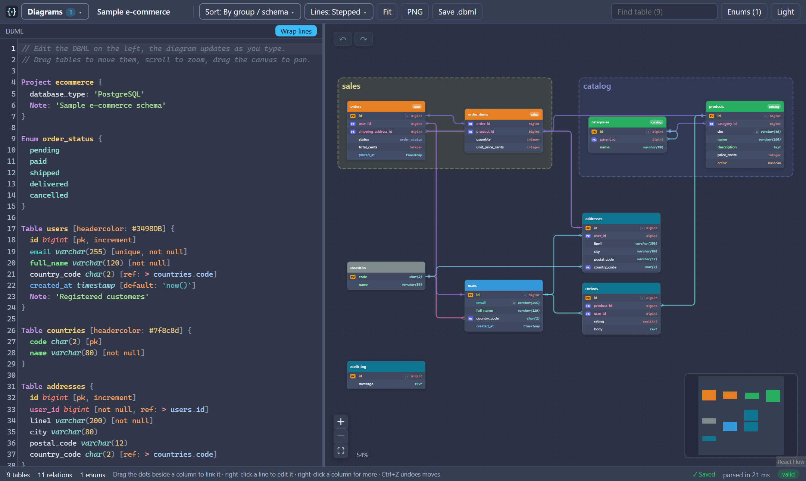
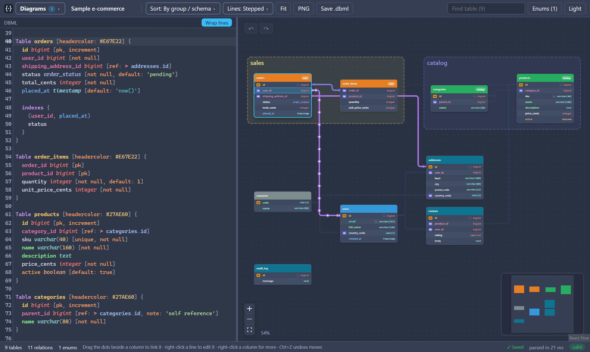
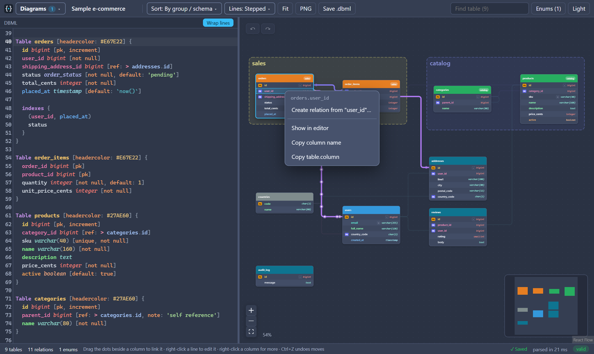
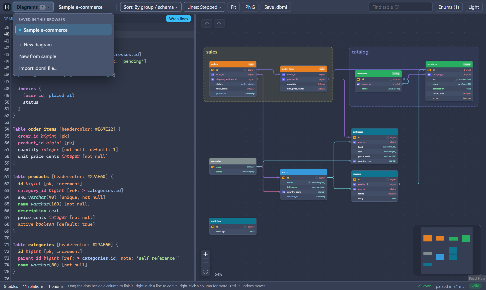
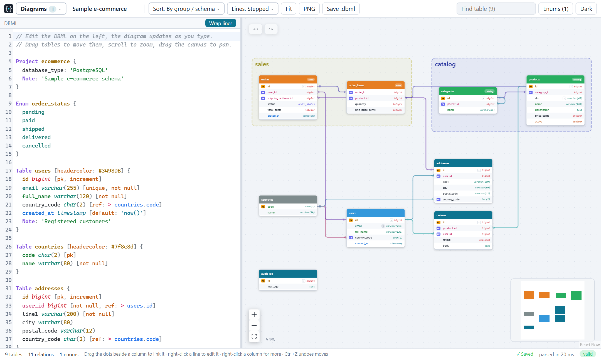

# dbdiagram-app

A browser-based database diagram tool. Write your schema in [DBML](https://dbml.dbdiagram.io/docs/) on the left and get a live, interactive entity-relationship diagram on the right. Everything runs in the browser and your diagrams are saved locally, so there is no account and no server.



## Features

- **Live DBML editor**: syntax highlighting, inline error and warning markers, and the last valid diagram stays on screen while you fix a typo. Parsing runs in a Web Worker, so typing stays smooth on large schemas.
- **Interactive diagram**: drag tables, pan, zoom, fit to view, and a minimap. `Ctrl+Z` / `Ctrl+Shift+Z` undo and redo table moves.
- **Relations you can follow**: click a column and its relations light up with animated dots running along each line.

  

- **Edit the schema from the diagram**: drag from the dots beside a column to create a relation, or right-click a line to change its type, change either end, or delete it. The DBML text is updated for you.

  

- **Auto layout**: By group / schema, Hierarchy (left to right or top to bottom), Clusters, Compact, Grid A-Z and Circular. The sort is remembered per diagram.
- **Line styles**: Bundled, Curved, Stepped or Straight.
- **Multiple diagrams**: create, duplicate, rename, delete and switch between saved diagrams, or start from the built-in sample.

  

- **Import and export**: open or drag in a `.dbml` file, save your schema as `.dbml`, or download the current view as a PNG.
- **Find and inspect**: search tables by name, list enums, and see PK, FK, unique and not-null markers and column types at a glance.
- **Light and dark themes**, with table header colours taken from `headercolor` in your DBML.

<details>
<summary>Light theme</summary>



</details>

## Getting started

You need a recent [Node.js](https://nodejs.org/) (22 LTS or newer).

```bash
npm install
npm run dev
```

Then open the URL Vite prints (usually http://localhost:5173).

| Command | What it does |
| --- | --- |
| `npm run dev` | Start the dev server with hot reload |
| `npm run build` | Type-check and build to `dist/` |
| `npm run preview` | Serve the production build locally |

## A taste of DBML

```dbml
Table users [headercolor: #3498DB] {
  id bigint [pk, increment]
  email varchar(255) [unique, not null]
  country_code char(2) [ref: > countries.code]
}

Table orders {
  id bigint [pk, increment]
  user_id bigint [not null]
  status order_status [not null, default: 'pending']
}

Ref: orders.user_id > users.id
```

Tables, enums, table groups, indexes, notes and inline or standalone `Ref`s are supported; see the sample diagram in the app for a fuller example.

## Built with

[React](https://react.dev/), [Vite](https://vite.dev/), [TypeScript](https://www.typescriptlang.org/), [@dbml/core](https://www.npmjs.com/package/@dbml/core) for parsing, [React Flow](https://reactflow.dev/) and [dagre](https://github.com/dagrejs/dagre) for the diagram and layout, [CodeMirror](https://codemirror.net/) for the editor, and [html-to-image](https://github.com/bubkoo/html-to-image) for PNG export.

## Where your data lives

Diagrams are stored in your browser's `localStorage` (keys prefixed with `dbdiagram:`). Clearing site data deletes them, so use **Save .dbml** for anything you want to keep.

---

Created in [T3 Code](https://t3.codes).
